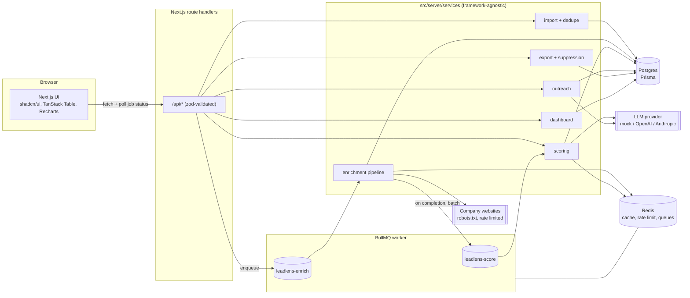
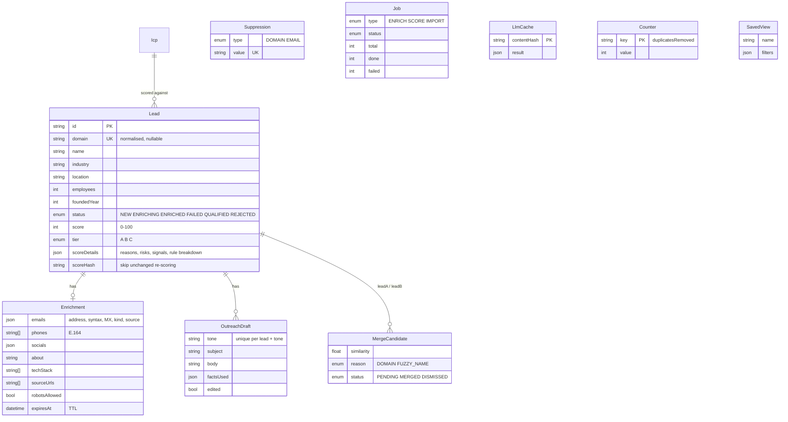

# LeadLens

AI-powered lead qualification for small-business acquisition sourcing. Built as a challenge submission for Caprae Capital.

Define who you want to buy (an **ICP**), bring in companies (CSV, pasted list, or discovery), and LeadLens cleans, enriches and de-duplicates them, then ranks every company by fit with a **plain-English explanation** and a **fact-grounded outreach draft**. Export the result to a CRM. Opt-outs are enforced, not just recorded.

| Dashboard | Leads workspace |
| --- | --- |
|  |  |
| **Lead drawer: score, contacts, outreach** | **Ethics & compliance** |
|  |  |

> Screenshots are generated, not hand-made: start the stack and the worker, then run `npm run screenshots` (see [Screenshots](#screenshots)). If the images above are missing, that command has not been run yet.

## Contents

- [What it does](#what-it-does)
- [Quick start](#quick-start)
- [Architecture](#architecture)
- [Data model](#data-model)
- [How scoring works](#how-scoring-works)
- [Enrichment, ethics and compliance](#enrichment-ethics-and-compliance)
- [Caching and performance decisions](#caching-and-performance-decisions)
- [Configuration](#configuration)
- [Testing](#testing)
- [Deployment](#deployment)
- [Trade-offs](#trade-offs)
- [What I would build next](#what-i-would-build-next)

## What it does

| Area | Details |
| --- | --- |
| **ICP builder** | Industries, locations, employee range, include/exclude keywords, and four signal toggles (owner-operated, long-established, no recent funding, hiring slowdown). Save as many ICPs as you like. |
| **Ingestion** | CSV upload or pasted list; discovery from a seed dataset (`data/sample_companies.csv`, ~150 fictional SMBs) behind a `LeadSource` interface so real providers can be dropped in. |
| **Enrichment** | One queued job per lead. Fetches the company's own public pages (robots.txt respected), extracts business emails, phones, socials, about text and tech hints, validates emails (syntax + MX) and normalises phones and domains. |
| **Dedupe** | Exact on normalised domain, then fuzzy on company name. Probable duplicates are shown for a human to merge or dismiss. |
| **AI scoring** | 0-100 fit score: deterministic rules blended with an LLM read of the company text. Output is zod-validated `{score, tier, reasons[], risks[], acquisitionSignals[]}`. |
| **Outreach** | Short cold email in three tones (formal, friendly, founder-to-founder). Only cites facts from the enrichment record. Editable and copyable. |
| **Workspace** | Sortable, filterable, searchable table with saved views, a detail drawer, bulk actions (re-enrich, score, qualify/reject, export). |
| **Export** | HubSpot-style CSV and raw JSON, for the selection or the current filters. Suppressed companies and emails are removed. |
| **Dashboard** | Leads by tier, average score by industry, enrichment success rate, duplicates removed. |
| **Compliance** | Plain statement of sources and crawler behaviour, plus a working opt-out list. |

## Quick start

Requirements: Node 18.18+ (Node 20 recommended; the Docker image uses 20) and Docker.

```bash
cp .env.example .env
docker compose up -d            # Postgres (host port 5442) and Redis (host port 6380)
npm install
npx prisma migrate deploy       # or: npm run db:migrate
npm run db:seed                 # two example ICPs and a sample opt-out
npm run dev                     # web app on http://localhost:3000
npm run worker                  # in a second terminal: enrichment + scoring worker
```

Then open <http://localhost:3000>, go to **Import & Discover**, press **Discover companies** with "Enrich after import" on, and watch the jobs tray on the **Leads** page. Scores appear as soon as each lead is enriched.

**Everything in containers** (web, worker, migrations, Postgres, Redis):

```bash
docker compose --profile app up --build
```

No API keys are needed: `LLM_PROVIDER=mock` is the default, and the seed data uses reserved `.example` domains that are answered by a built-in synthetic site generator, so enrichment works offline and is deterministic. Set `LLM_PROVIDER=openai` or `anthropic` plus the key to use a real model; point real domains at it to crawl real sites.

Useful scripts:

| Script | Purpose |
| --- | --- |
| `npm run dev` / `build` / `start` | Next.js |
| `npm run worker` | BullMQ worker (enrich concurrency from env, score concurrency 2) |
| `npm test` | Unit tests (Vitest) |
| `npm run e2e` | Playwright smoke test (needs Postgres + Redis) |
| `npm run screenshots` | Regenerate README screenshots |
| `npm run typecheck` / `lint` | TypeScript strict / ESLint |
| `npm run db:studio` | Prisma Studio |
| `npm run data:generate` | Regenerate the seed CSV (deterministic) |

## Architecture



Design rules that shaped the code:

- **Services own the logic; routes are thin.** Everything in `src/server/services` takes plain arguments and dependencies (fetchers, MX resolver, LLM provider), so it is unit-tested with fakes and could be moved to Lambda or another framework unchanged.
- **Postgres is the source of truth for job state.** BullMQ moves work; a `Job` row (`total/done/failed`) is what the UI polls, so progress survives a Redis flush and works the same whether jobs run in a long-lived worker or a serverless function.
- **Everything external sits behind an interface**: `LeadSource`, `LLMProvider`, the HTTP `Fetcher`, the `MxResolver`.
- **One error format** for every route: `{ "error": { "code", "message", "details?" } }`, with zod failures mapped to `400 VALIDATION_ERROR`.

Repository layout:

```
prisma/                 schema, migrations, seed
data/                   sample_companies.csv (generated)
src/app/                pages (app router) and /api route handlers
src/components/         UI (ui/ primitives, leads/, icp/, dashboard/, compliance/)
src/lib/                env, logger, api helpers, shared zod schemas, client hooks
src/server/
  ai/                   provider interface, OpenAI, Anthropic, mock
  cache/                Redis client, cache helpers, rate limiter
  queue/                BullMQ queues, producers, processors
  sources/              LeadSource implementations (csv, seed)
  services/             import, dedupe, enrichment, scoring, outreach, export, dashboard, suppression
worker/index.ts         worker entrypoint
tests/unit, tests/e2e   Vitest and Playwright
```

## Data model



Indexes: `Lead.domain` (unique), `Lead.tier`, `Lead.status`, `(icpId, score)`, `industry`; `Enrichment.expiresAt`; `MergeCandidate.status`; `Job.status`.

## How scoring works

Final score = `round(0.6 × rules + 0.4 × llm)`. If the LLM is unavailable or returns something invalid twice, the score is rules-only and says so in the risks list. **The tier is always derived by us** (A at 75 or above, B at 50 or above, otherwise C), never taken from the model.

**Rules (0-100, fully deterministic and explainable):**

| Component | Max | Notes |
| --- | --- | --- |
| Industry | 30 | Exact match full credit, partial for near matches |
| Size | 25 | In range full, just outside half, unknown is a flagged risk not a zero |
| Location | 15 | State codes match on word boundaries |
| Keywords | 15 | Include keywords found in the company text |
| Signals | 15 | Owner-operated, long-established, no recent funding, hiring slowdown, detected from text and founded year |
| Exclude keywords | -25 | Penalty, capped |

**LLM:** leads are scored in batches of 8 per request. The prompt contains the ICP and each company's facts; the response must satisfy a zod schema (`score` 0-100, bounded reason lists). On a validation failure the request is retried once with the error appended, then falls back to rules-only. Results are cached by a SHA-256 of prompt version, provider and model, ICP criteria and lead facts, so a re-run on unchanged data makes no LLM calls.

**Outreach is grounded.** The prompt receives a numbered fact sheet and may only cite those ids. Every draft is checked for unknown fact ids, numbers that are not in the facts, leftover placeholders, the company name, and at least one specific fact. Failing drafts get one retry with the problems listed; after that a deterministic template built only from the facts is used. Suppressed domains return `409`.

## Enrichment, ethics and compliance

- **Only public, company-published pages** on the lead's own domain. Never LinkedIn (links a company publishes on its own site are recorded but never fetched), never logged-in or personal pages.
- **robots.txt (RFC 9309):** longest match wins, Allow beats Disallow on ties, `*` and `$` wildcards, Crawl-delay, group selection by product token. 404 means allowed; 401/403/5xx means we do not crawl.
- **Identified:** requests use `ENRICHMENT_USER_AGENT`.
- **Rate limited per domain** with a Redis slot (`SET NX PX`) shared across workers, default 1 request per 1.5 s; timeouts and retries with exponential backoff and jitter, honouring `Retry-After`.
- **SSRF guard:** private and internal addresses (including after DNS resolution) are refused, redirects must stay on the same domain, and response bodies are size-capped.
- **Opt-outs are enforced** in three places: enrichment never fetches suppressed domains, outreach refuses them, and **export removes suppressed companies and strips suppressed emails** (a domain entry also covers its subdomains). The export response reports how many were removed.
- **CSV injection:** exported cells beginning with `=`, `+`, `-`, `@` are neutralised unless they are real phone numbers or numbers.

The live statement, with values from your configuration, is on the **Ethics & Compliance** page.

## Caching and performance decisions

| What | Where | Key | TTL / behaviour |
| --- | --- | --- | --- |
| Enrichment snapshot | Redis, then Postgres | `enrich:{domain}` | Resolution order is Redis, then Postgres row with fresh `expiresAt`, then live crawl. TTL `ENRICHMENT_TTL_HOURS` (168). Failures cached for 1 h so a dead site is not hammered. |
| robots.txt | Redis | per origin | Cached so a batch of leads on one domain fetches it once |
| MX lookups | Redis | per email domain | Cached; DNS is the slowest part of email validation |
| LLM results | Redis + Postgres `LlmCache` | `llm:{contentHash}` | Content-addressed, so a changed ICP or changed company text naturally misses; Postgres copy survives a Redis flush |
| Skip unchanged scoring | `Lead.scoreHash` | hash of inputs | Unchanged leads are skipped without even reading the cache |
| Per-domain crawl slot | Redis | `SET NX PX` | Enforces the politeness delay across all workers |
| API rate limits | Redis | fixed window | Enrich, score, outreach and export endpoints |

Other choices: LLM calls are **batched** (8 leads per request) to cut latency and cost; scoring runs in its own queue so enrichment is never blocked by the model; the table is server-paginated and sorted with indexes behind each filter; unscored leads always sort last; all Redis caching **fails open**, so a Redis outage slows things down but does not break reads.

## Configuration

Copy `.env.example`. Nothing secret is committed.

| Variable | Default | Purpose |
| --- | --- | --- |
| `DATABASE_URL` | local compose | Postgres (Neon in production) |
| `REDIS_URL` | local compose | Redis (Upstash in production) |
| `LLM_PROVIDER` | `mock` | `mock`, `openai` or `anthropic` |
| `OPENAI_API_KEY`, `OPENAI_MODEL` | - , `gpt-4o-mini` | |
| `ANTHROPIC_API_KEY`, `ANTHROPIC_MODEL` | - , `claude-3-5-haiku-latest` | |
| `ENRICHMENT_USER_AGENT` | LeadLensBot/1.0 | **Change this to include a real contact URL/email before crawling real sites** |
| `ENRICHMENT_TTL_HOURS` | 168 | Cache lifetime |
| `ENRICHMENT_DOMAIN_DELAY_MS` | 1500 | Per-domain politeness delay |
| `ENRICHMENT_TIMEOUT_MS` | 8000 | Per request |
| `ENRICHMENT_CONCURRENCY` | 4 | Parallel enrich jobs per worker |
| `ENRICHMENT_OFFLINE` | false | Skip real HTTP and synthesise from seed data |
| `OUTREACH_SENDER_NAME`, `OUTREACH_SENDER_FIRM` | Alex Morgan, Caprae Capital | Used in drafts |
| `LOG_LEVEL` | info | Structured JSON logs via pino |

`GET /api/health` reports database and Redis status for load balancers.

## Testing

```bash
npm test         # unit tests
npm run e2e      # Playwright smoke test (needs docker compose up -d postgres redis)
```

Unit tests cover: robots.txt parsing and matching, dedupe and name similarity, email validation (syntax, MX, classification), the crawl extractor, scoring rules and signal detection, score blending and schema, content hashing, outreach fact sheets, templates and the hallucination guard, structured-output retry behaviour, and CSV export, formula-injection defence and suppression enforcement.

The Playwright smoke test imports a company, finds it, exports it, adds an opt-out on the compliance page and proves the next export leaves the company out, then cleans up after itself.

## Deployment

### Vercel + Neon + Upstash (recommended)

1. **Neon:** create a project, copy the pooled connection string into `DATABASE_URL`. Run `npx prisma migrate deploy` once against it (locally with `DATABASE_URL` set, or in CI).
2. **Upstash:** create a Redis database, copy the TLS URL (`rediss://default:<token>@<host>:6379`) into `REDIS_URL`.
3. **Vercel:** import the repo, set `DATABASE_URL`, `REDIS_URL`, `LLM_PROVIDER` and the provider key, and `ENRICHMENT_USER_AGENT`. The build command `npm run build` already runs `prisma generate`.
4. **Worker:** Vercel functions cannot host a long-lived BullMQ worker. Run `npm run worker` (or the same Docker image with command `npm run worker`) on any always-on host, such as Fly.io, Railway, Render or a small VM, with the **same** `DATABASE_URL` and `REDIS_URL`. The web app only enqueues and reads state, so it works without the worker; jobs simply wait in the queue.
5. Upstash bills per command and BullMQ polls; keep `drainDelay` generous on the worker if cost matters, or use a plain Redis instance for the queue and Upstash only for cache.

### AWS alternative

- **Web:** the Docker image on ECS Fargate behind an ALB (or App Runner), or `next build` output on Lambda via an adapter such as OpenNext.
- **Database:** RDS for PostgreSQL (or Aurora Serverless v2), reachable from the VPC; run migrations as a one-off ECS task using the compose `migrate` command.
- **Redis:** ElastiCache for Redis in the same VPC (TLS on, `rediss://`).
- **Worker:** a second ECS service from the same image with command `npm run worker`. For bursty workloads, move the enrich processor to **Lambda behind SQS**: `processEnrichJob` is framework-agnostic, so the handler is a thin wrapper; keep the per-domain Redis slot so concurrent invocations stay polite.
- **Secrets:** AWS Secrets Manager or SSM Parameter Store injected as environment variables.
- **Egress:** crawler traffic leaves through a NAT gateway with a stable IP, which also gives site owners one address to allow or block.

### Docker

One image (`Dockerfile`, Node 20) runs either role: `npm run start` for web or `npm run worker`. `docker compose --profile app up --build` wires both to Postgres and Redis.

## Screenshots

With Postgres, Redis, `npm run dev` and `npm run worker` running:

```bash
npx playwright install chromium   # first time only
npm run screenshots
```

This seeds an ICP if there is none, discovers and enriches the sample dataset, waits for the jobs to drain, and writes PNGs to `docs/screenshots/`.

## Trade-offs

- **No authentication.** One workspace, no users. Right for a challenge and a demo; the first thing to add for real use. Opt-outs and exports are therefore unauthenticated too.
- **One `status` enum mixes pipeline state and review decision** (`NEW`/`ENRICHING`/`ENRICHED`/`FAILED` and `QUALIFIED`/`REJECTED`). It keeps the table and filters simple. To avoid losing human decisions, pipeline updates never overwrite `QUALIFIED` or `REJECTED`. The clean fix is two columns.
- **`mock` is the default LLM.** It is a deterministic heuristic that reads the same inputs, which makes demos and tests reproducible but is not intelligence. Real models are one env var away; validation and fallbacks behave the same.
- **Seed companies are fictional** and use `.example` domains, which the fetcher answers with a deterministic synthetic site (about 4% robots-blocked and 3% unreachable by hash, so failure paths are visible). The real extractor, validators and robots logic still run on that content. Real domains go through the real network path.
- **Fuzzy dedupe is conservative.** Name similarity is Fuse.js candidates confirmed by Levenshtein at 0.85 with a state-conflict guard; near-misses are surfaced for a human, never auto-merged. Domainless leads can only match by name.
- **`duplicatesRemoved` counts re-imports too**, so importing the same file twice raises it. It measures cleanup work done, not distinct duplicates.
- **MX validation does not prove a mailbox exists.** No SMTP probing, deliberately: it is slow, often blocked, and borderline abusive.
- **Fixed-window rate limiting** is simple and good enough for these endpoints; a sliding window would be smoother at boundaries.
- **Export is capped at 5,000 rows** per file and built in memory. Fine here; stream it for more.
- **Node 18 support needed a `File` polyfill** for cheerio's undici dependency. On Node 20+ it is a no-op.
- **Charts and UI are tested by hand and by one smoke test**, not by component tests.

## What I would build next

1. **Auth and multi-tenancy:** users, workspaces, per-workspace ICPs, leads and suppression lists, audit log of exports.
2. **Real discovery sources** behind `LeadSource` (licensed data providers, Google Places, state business registries) with per-source terms recorded in the compliance page.
3. **Succession-risk modelling:** founder age proxies, long tenure, absence of a clear second layer of management, calibrated against deals the firm actually closed. Feed outcomes (qualified, rejected, won) back to tune weights.
4. **Review queue UX:** keyboard-driven triage, side-by-side merge, and explicit pipeline vs review status.
5. **CRM sync:** push to HubSpot or Salesforce via API with field mapping and duplicate checks, instead of CSV.
6. **Outreach loop:** sequence scheduling, bounce handling, reply tracking, and a per-recipient suppression link in every email.
7. **Observability:** OpenTelemetry traces across web, queue and worker; per-provider LLM cost and latency dashboards; alerting on queue depth and enrichment success rate.
8. **Streaming exports and large imports**, plus a resumable chunked CSV upload.
9. **Evaluation harness** for the scorer and the outreach guard, with a labelled set of companies to track precision as prompts change.
